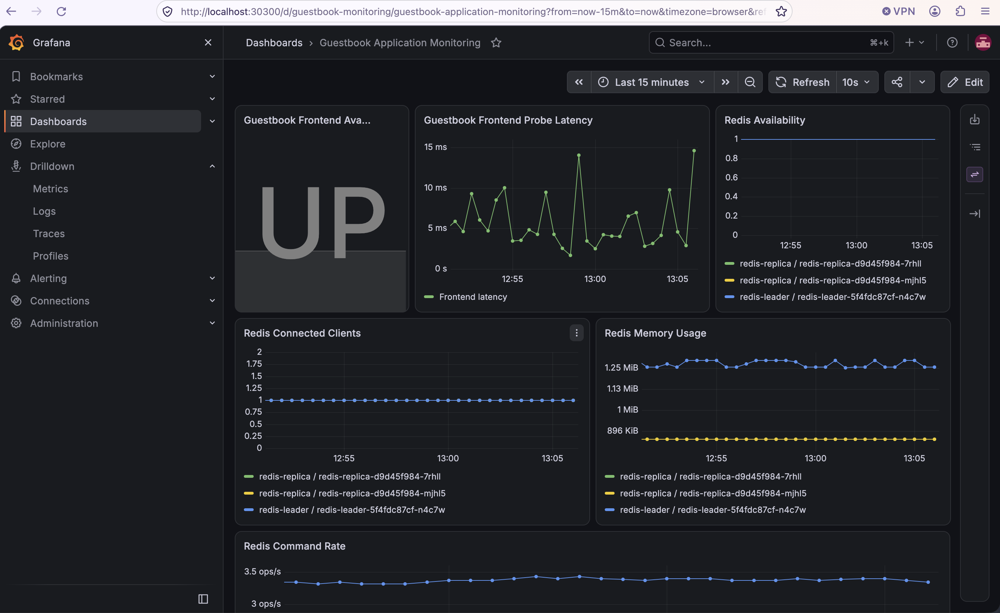

# Kubernetes Guestbook Monitoring with Pulumi

This project extends the Pulumi Kubernetes Guestbook example with a complete monitoring stack using **Prometheus and Grafana**.

The infrastructure is deployed declaratively using **Pulumi TypeScript** and includes application monitoring for both the Redis backend and Guestbook frontend.

## Architecture

```text
                         Pulumi TypeScript
                               |
              +----------------+----------------+
              |                                 |
        Guestbook Namespace              Monitoring Namespace
              |                                 |
      +-------+-------+                 kube-prometheus-stack
      |               |                        |
   Frontend         Redis                 +-----+------+
   3 replicas     Leader + Replicas       |            |
      |               |              Prometheus     Grafana
      |               |                   |
      |        redis_exporter              |
      |            :9121                   |
      |               |                    |
      |        ServiceMonitor -------------+
      |
      +---- Blackbox Exporter
                  |
             ServiceMonitor
                  |
              Prometheus
```

## Features

- Kubernetes Guestbook application deployed with Pulumi
- Redis leader and two Redis replicas
- Prometheus and Grafana deployed using `kube-prometheus-stack`
- Redis Prometheus exporter sidecars
- Prometheus `ServiceMonitor` resources for Redis
- Blackbox Exporter for Guestbook HTTP availability and latency
- kube-state-metrics for Kubernetes observability
- Grafana exposed using a Kubernetes `NodePort`
- Dynamically generated Grafana administrator password
- Pulumi secret handling for Grafana credentials
- Automatically provisioned Grafana dashboard
- Health checks and resource limits for application containers

## Monitoring

### Redis

Each Redis pod contains a `redis_exporter` sidecar exposing Prometheus metrics on port `9121`.

Example metrics:

```text
redis_up
redis_connected_clients
redis_memory_used_bytes
redis_commands_processed_total
redis_keyspace_hits_total
redis_keyspace_misses_total
```

Prometheus discovers the Redis metrics using Kubernetes `ServiceMonitor` resources.

### Guestbook Frontend

The original Guestbook frontend does not expose a native Prometheus `/metrics` endpoint.

Instead, Prometheus Blackbox Exporter performs HTTP probes against the frontend service.

Example metrics:

```text
probe_success
probe_duration_seconds
probe_http_status_code
probe_http_duration_seconds
```

This provides application availability and latency monitoring without modifying the original Guestbook application.

## Grafana Dashboard

A Grafana dashboard is automatically provisioned through a Kubernetes ConfigMap managed by Pulumi.

The dashboard includes:

- Guestbook frontend availability
- Guestbook HTTP probe latency
- Redis availability
- Redis connected clients
- Redis memory usage
- Redis command rate

Screenshot:



## Technologies

- Pulumi
- TypeScript
- Kubernetes
- Docker Desktop Kubernetes
- Helm
- Prometheus
- Prometheus Operator
- Grafana
- Blackbox Exporter
- Redis Exporter
- kube-state-metrics

## Project Structure

```text
.
├── Pulumi.yaml
├── README.md
├── dashboard.ts
├── guestbook.ts
├── index.ts
├── monitoring.ts
├── package.json
├── package-lock.json
├── tsconfig.json
└── screenshots/
    └── grafana-dashboard.png
```

## Prerequisites

A Kubernetes cluster and the following tools are required:

- Docker
- Kubernetes
- Node.js
- npm
- Pulumi CLI
- kubectl

This project was validated using Docker Desktop Kubernetes.

Helm does not need to be installed separately because Pulumi manages the Helm releases through the Kubernetes provider.

## Install Dependencies

```bash
npm install
```

Verify TypeScript compilation:

```bash
npm run build
```

## Configure Pulumi

A local Pulumi backend can be used:

```bash
mkdir -p .pulumi-state
export PULUMI_CONFIG_PASSPHRASE="<choose-a-secure-passphrase>"

pulumi login file://$PWD/.pulumi-state
```

Create or select a stack:

```bash
pulumi stack init dev
```

If the stack already exists:

```bash
pulumi stack select dev
```

Configure the Kubernetes context:

```bash
pulumi config set kubernetes:context docker-desktop
```

Replace `docker-desktop` with the appropriate context when deploying to another Kubernetes cluster.

## Preview Deployment

Before deploying:

```bash
pulumi preview
```

## Deploy

Deploy the complete environment:

```bash
pulumi up
```

Review the proposed changes and approve the deployment.

The deployment creates:

- Guestbook namespace
- Monitoring namespace
- Guestbook frontend
- Redis leader
- Redis replicas
- Redis exporters
- Prometheus
- Grafana
- Blackbox Exporter
- kube-state-metrics
- ServiceMonitor resources
- Grafana dashboard

## Verify Kubernetes Resources

Check Guestbook workloads:

```bash
kubectl get pods -n guestbook
```

Expected application pods include:

```text
frontend
frontend
frontend
redis-leader
redis-replica
redis-replica
```

Redis pods should report `2/2` containers because each pod contains Redis and a Redis exporter.

Check monitoring workloads:

```bash
kubectl get pods -n monitoring
```

Check services:

```bash
kubectl get svc -n guestbook
kubectl get svc -n monitoring
```

Check ServiceMonitor resources:

```bash
kubectl get servicemonitor -A
```

## Access the Guestbook

On Docker Desktop Kubernetes:

```text
http://localhost
```

The frontend service is deployed as a Kubernetes `LoadBalancer`.

Verify from the command line:

```bash
curl -I http://localhost
```

A healthy deployment should return:

```text
HTTP/1.1 200 OK
```

## Access Grafana

Pulumi outputs the Grafana access information.

```bash
pulumi stack output grafanaAccessUrl
```

For Docker Desktop the URL is:

```text
http://localhost:30300
```

Grafana username:

```text
admin
```

The password is generated dynamically and stored as a Pulumi secret.

Retrieve it intentionally using:

```bash
pulumi stack output grafanaPassword --show-secrets
```

The password is not stored in source control.

## Verify Prometheus Metrics

Port-forward Prometheus:

```bash
kubectl -n monitoring \
  port-forward \
  svc/monitoring-kube-prometheus-prometheus \
  9090:9090
```

Open:

```text
http://localhost:9090
```

### Verify Redis

Run:

```promql
redis_up
```

A healthy deployment returns three series with value `1`:

- Redis leader
- Redis replica 1
- Redis replica 2

Additional examples:

```promql
redis_connected_clients
```

```promql
redis_memory_used_bytes
```

```promql
rate(redis_commands_processed_total[5m])
```

### Verify Guestbook Availability

Run:

```promql
probe_success{app="guestbook"}
```

Expected:

```text
1
```

A value of `1` indicates that Blackbox Exporter successfully reached the Guestbook frontend.

### Verify Guestbook Latency

Run:

```promql
probe_duration_seconds{app="guestbook"}
```

This returns the total duration of the frontend HTTP probe.

## Grafana Dashboard

After signing into Grafana:

```text
Dashboards
→ Guestbook Application Monitoring
```

The dashboard is provisioned automatically by Pulumi and therefore does not require manual configuration.

## Security Considerations

- Grafana credentials are not hard-coded.
- The Grafana password is generated dynamically.
- The password is handled as a Pulumi secret.
- Local Pulumi state is excluded from Git.
- Kubernetes kubeconfig files are excluded from Git.
- Local environment files are excluded from Git.
- Container resource requests and limits are configured.
- Application workloads include readiness and liveness probes.

The following local files should never be committed:

```text
.env.pulumi
.kubeconfig.docker-desktop
.pulumi-state/
```

## Docker Desktop Note

Host-level Prometheus Node Exporter is disabled for this local Docker Desktop deployment because Docker Desktop uses a virtualized Linux environment that differs from a standard Linux Kubernetes node.

Application-level Redis metrics, Guestbook HTTP monitoring, and Kubernetes metrics remain fully available through Redis Exporter, Blackbox Exporter, kube-state-metrics, and Prometheus.

Node Exporter can be enabled when deploying to standard Linux Kubernetes nodes.

## Destroy the Environment

Remove all resources managed by this Pulumi stack:

```bash
pulumi destroy
```

After confirming destruction, the local stack may optionally be removed:

```bash
pulumi stack rm dev
```

## Validation

The completed environment was validated with:

```text
Guestbook frontend: HTTP 200
Redis leader:       redis_up = 1
Redis replica 1:    redis_up = 1
Redis replica 2:    redis_up = 1
Frontend probe:     probe_success = 1
Grafana dashboard:  Provisioned successfully
```

## Assignment Objective

This implementation demonstrates how Pulumi can be used to deploy an application and its observability stack together as reproducible infrastructure-as-code.

Prometheus automatically discovers application monitoring targets, while Grafana provides a preconfigured visualization layer for Guestbook availability, latency, and Redis performance metrics.